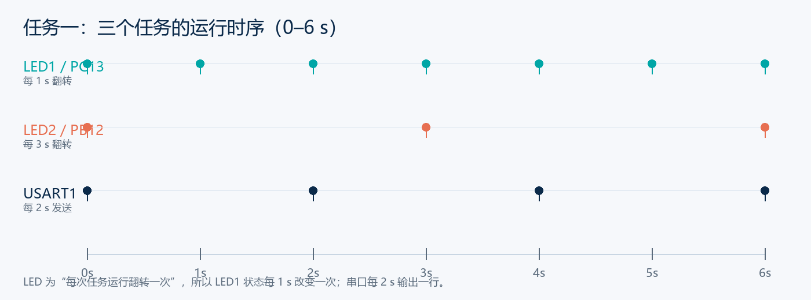
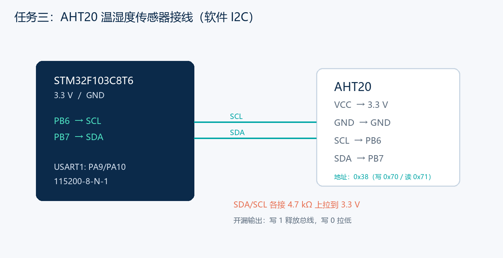

# 从裸机到 RTOS 再到 AHT20：STM32F103C8T6 任务一 & 任务二复盘

> 这次把两个实验放在一起写：**任务一**把裸机工程移植到 uC/OS-III，用三个任务分别控制两颗 LED 和一路串口；**任务二**在 RTOS 工程里接上 AHT20 温湿度传感器，用软件 I2C 每 2 s 读取一次温度、湿度，通过 USART1 输出。
>
> 两个实验一个偏“底层调度”，一个偏“传感器驱动”。任务一最难的不是写任务，而是让 `OSStart()` 真正切到第一个任务；任务二最难的不是调 API，而是把软件 I2C 时序、AHT20 命令、CRC 校验和 RTOS 延时接对。
>
> 开发环境：**STM32F103C8T6（Blue Pill）+ STM32CubeMX + Keil MDK5 + HAL 库 + ST-Link V2**。  
> 任务一：uC/OS-III V3.08，1 kHz tick，USART1 115200。  
> 任务二：AHT20 温湿度传感器，软件 I2C（PB6/PB7），4.7 kΩ 上拉，USART1 输出。

---

## 一、先看两个任务的结果

### 1. 任务一

| 任务 | 优先级 | 栈大小 | 周期 | 现象 |
| --- | --- | --- | --- | --- |
| LED1 | 2 | 128 words | 1 s | PC13 每 1 s 翻转一次 |
| LED2 | 3 | 128 words | 3 s | PB12 每 3 s 翻转一次 |
| UART | 4 | 256 words | 2 s | 串口输出 hello 信息 |

串口输出：

```text
hello uc/OS! 欢迎来到RTOS多任务环境！
```

任务时序示意：



> 图中的“翻转”是任务每次运行时改变一次 LED 状态。所以 LED1 的亮/灭状态每 1 s 改变一次，完整亮灭循环是 2 s；LED2 完整循环是 6 s。任务书如果要求“1 s 完整亮灭”，把延时改成 500 ms，并在报告里说明任务周期改为 0.5 s。

### 2. 任务二

AHT20 每 2 s 读取一次温度和湿度，串口输出示例：

```text
AHT20: T=26.4 C, RH=55.3 %
AHT20: T=26.4 C, RH=55.2 %
AHT20: T=26.5 C, RH=55.4 %
```

| 项目 | 结果 |
| --- | --- |
| 传感器 | AHT20，I2C 7 位地址 0x38 |
| 接口 | 软件 I2C，SCL=PB6，SDA=PB7 |
| 上拉 | SDA/SCL 各 4.7 kΩ 到 3.3 V |
| 读取周期 | 2 s |
| 输出 | 温度、湿度，保留 1 位小数 |
| 校验 | CRC8，多项式 0x31，初值 0xFF |

> 数值会随环境变化，上面的 26.4 ℃ / 55.3 % 只是当时的一组实测示例。

## 二、硬件与环境

### 1. 任务一接线

| 信号 | STM32F103C8T6 | 接到哪里 | 说明 |
| --- | --- | --- | --- |
| LED1 | PC13 | 板载 LED | 低电平点亮（以实物为准） |
| LED2 | PB12 | 外接 LED + 330 Ω | 低电平点亮或高电平点亮均可，代码只做翻转 |
| USART1_TX | PA9 | USB-TTL 的 RX | 交叉连接 |
| USART1_RX | PA10 | USB-TTL 的 TX | 交叉连接 |
| GND | GND | USB-TTL GND | 必须共地 |
| SWD | PA13/PA14 | ST-Link | 下载与调试 |

### 2. 任务二接线

| AHT20 | STM32F103C8T6 | 说明 |
| --- | --- | --- |
| VCC | 3.3 V | 不要接 5 V |
| GND | GND | 共地 |
| SCL | PB6 | 软件 I2C SCL，4.7 kΩ 上拉 |
| SDA | PB7 | 软件 I2C SDA，4.7 kΩ 上拉 |



AHT20 的 7 位地址是 `0x38`，写地址 `0x70`，读地址 `0x71`。模块一般自带 4.7 kΩ 上拉；如果买的是裸传感器，必须自己加上拉，否则 SDA 释放不回高电平，读不到 ACK。

## 三、任务一：把 uC/OS-III 移植到 STM32F103

### 1. 源码准备

需要三部分源码，缺一不可：

```text
Middlewares/
├─ uC-CPU/
│  ├─ cpu_core.c / cpu_core.h / cpu_def.h / cpu_cache.h
│  └─ ARM-Cortex-M/ARMv7-M/
│     ├─ ARM/cpu.h
│     ├─ ARM/cpu_a.asm
│     └─ cpu_c.c
├─ uC-LIB/
│  ├─ lib_ascii.c/h
│  ├─ lib_math.c/h
│  ├─ lib_mem.c/h
│  ├─ lib_str.c/h
│  └─ lib_def.h
└─ uC-OS3/
   ├─ Source/                # 内核 .c/.h
   └─ Ports/ARM-Cortex-M/ARMv7-M/
      ├─ os_cpu_c.c
      └─ ARM/os_cpu.h、os_cpu_a.asm
```

V3.08 的端口路径是 `Ports/ARM-Cortex-M/ARMv7-M/ARM`；V3.04 常见路径是 `Ports/ARM-Cortex-M3/Generic/Keil`。目录名可以不同，但 Include Paths 必须对应。

Keil 里建 5 个组：

```text
uC-CPU
uC-LIB
uC-OS3
uC-OS3-Port
App
```

把 `cpu_core.c`、`cpu_c.c`、`cpu_a.asm`、`lib_*.c`、`os_*.c`、`os_cpu_c.c`、`os_cpu_a.asm`、`app.c` 分别加入。`os_cpu_a.asm` 和 `cpu_a.asm` 的文件类型要设成 **ARM Assembler**。

Include Paths 至少包含：

```text
..\App
..\Middlewares\uC-CPU
..\Middlewares\uC-CPU\ARM-Cortex-M\ARMv7-M
..\Middlewares\uC-CPU\ARM-Cortex-M\ARMv7-M\ARM
..\Middlewares\uC-LIB
..\Middlewares\uC-OS3\Source
..\Middlewares\uC-OS3\Ports\ARM-Cortex-M\ARMv7-M
..\Middlewares\uC-OS3\Ports\ARM-Cortex-M\ARMv7-M\ARM
```

### 2. CubeMX 配置

任务一用的 CubeMX 配置：

| 项目 | 配置 |
| --- | --- |
| 芯片 | STM32F103C8Tx |
| SYS → Debug | Serial Wire |
| RCC → HSE | Crystal/Ceramic Resonator |
| SYSCLK | 72 MHz |
| APB1 | 36 MHz |
| PC13 | GPIO_Output，User Label = LED1 |
| PB12 | GPIO_Output，User Label = LED2 |
| USART1 | Asynchronous，115200，8N1 |
| Toolchain | MDK-ARM V5 |

这里最容易犯的错是：**PB12 在 CubeMX 里是灰色，没配成输出**，但代码里却去翻转 PB12。灰色表示没有配置，代码不会驱动它。必须在引脚图上把 PB12 点成绿色，User Label 填 `LED2`。

生成后 `main.h` 应该有：

```c
#define LED1_Pin       GPIO_PIN_13
#define LED1_GPIO_Port GPIOC
#define LED2_Pin       GPIO_PIN_12
#define LED2_GPIO_Port GPIOB
```

如果没有，优先改 CubeMX 的 User Label，不要只在代码里硬写宏。

### 3. 四个配置文件

`App/cpu_cfg.h` 里最关键的是：

```c
#define CPU_CFG_NVIC_PRIO_BITS     4u
#define CPU_CFG_KA_IPL_BOUNDARY    4u
#define CPU_CFG_TS_32_EN           DEF_DISABLED
#define CPU_CFG_TS_64_EN           DEF_DISABLED
#define CPU_CFG_TS_TMR_SIZE        CPU_WORD_SIZE_32
#define CPU_CFG_CACHE_MGMT_EN      DEF_DISABLED
```

`App/os_cfg.h` 做了最小裁剪：只保留任务、延时、tick，关掉事件、队列、信号量、互斥量、内存管理、定时器和统计任务。C8T6 只有 20 KB RAM，第一次移植不要把功能全开。

`App/os_cfg_app.h` 里：

```c
#define OS_CFG_ISR_STK_SIZE        128u
#define OS_CFG_IDLE_TASK_STK_SIZE  128u
#define OS_CFG_TICK_RATE_HZ        1000u
```

`App/app_cfg.h` 里：

```c
#define APP_TASK_LED1_PRIO      2u
#define APP_TASK_LED2_PRIO      3u
#define APP_TASK_UART_PRIO      4u

#define APP_TASK_LED1_STK_SIZE  128u
#define APP_TASK_LED2_STK_SIZE  128u
#define APP_TASK_UART_STK_SIZE  256u
```

栈大小的单位是 `CPU_STK` 元素，不是字节。Cortex-M3 上 1 个元素 4 字节，所以 128 words = 512 B。

### 4. 三个任务

`app.c` 的核心：

```c
static void AppTaskLed1(void *p_arg)
{
    OS_ERR err;
    (void)p_arg;

    /* OSStart() 切到任务后再启动 1 ms OS tick。 */
    OS_CPU_SysTickInitFreq(SystemCoreClock);

    while (DEF_TRUE) {
        HAL_GPIO_TogglePin(LED1_GPIO_Port, LED1_Pin);
        OSTimeDlyHMSM(0u, 0u, 1u, 0u, OS_OPT_TIME_HMSM_STRICT, &err);
        if (err != OS_ERR_NONE) {
            Error_Handler();
        }
    }
}

static void AppTaskLed2(void *p_arg)
{
    OS_ERR err;
    (void)p_arg;

    while (DEF_TRUE) {
        HAL_GPIO_TogglePin(LED2_GPIO_Port, LED2_Pin);
        OSTimeDlyHMSM(0u, 0u, 3u, 0u, OS_OPT_TIME_HMSM_STRICT, &err);
        if (err != OS_ERR_NONE) {
            Error_Handler();
        }
    }
}
```

串口任务：

```c
static const char msg[] =
    "hello uc/OS! "
    "\xBB\xB6\xD3\xAD\xC0\xB4\xB5\xBD"
    "RTOS"
    "\xB6\xE0\xC8\xCE\xCE\xF1\xBB\xB7\xBE\xB3\xA3\xA1"
    "\r\n";

static void AppTaskUart(void *p_arg)
{
    OS_ERR err;
    (void)p_arg;

    while (DEF_TRUE) {
        HAL_UART_Transmit(&huart1, (uint8_t *)msg, sizeof(msg) - 1u, 100u);
        OSTimeDlyHMSM(0u, 0u, 2u, 0u, OS_OPT_TIME_HMSM_STRICT, &err);
        if (err != OS_ERR_NONE) {
            Error_Handler();
        }
    }
}
```

这里的中文用 **GBK 字节转义**，是为了让正点原子 XCOM 默认编码直接显示正常。因为 `app.c` 如果是 UTF-8，XCOM 按 GBK 解码就会变成“烧栈……”那类乱码。

### 5. 创建任务

V3.08 的 `OSTaskCreate()` 是 **13 个参数**，不是 11 个。少写 `q_size` 和 `time_quanta`，编译会报：

```text
too few arguments to function call, expected 13, have 11
```

正确写法：

```c
OSTaskCreate(&AppTaskLed1TCB,
             "LED1 Task",
             AppTaskLed1,
             (void *)0,
             APP_TASK_LED1_PRIO,
             &AppTaskLed1Stk[0],
             APP_TASK_LED1_STK_LIMIT,
             APP_TASK_LED1_STK_SIZE,
             0u,                 /* q_size */
             0u,                 /* time_quanta */
             (void *)0,
             OS_OPT_TASK_STK_CLR,
             &err);
```

三个任务都按这个格式创建。

### 6. 启动顺序

`main.c` 里只保留 OS 启动流程：

```c
HAL_Init();
SystemClock_Config();
MX_GPIO_Init();
MX_USART1_UART_Init();

CPU_Init();
OSInit(&err);
if (err != OS_ERR_NONE) {
    Error_Handler();
}

App_Init();
OSStart(&err);

while (1) {
}
```

`OSStart()` 不会返回。如果它返回了，说明任务没有创建成功或内核没启动。

### 7. SysTick 和 PendSV

`stm32f1xx_it.c` 里：

```c
void SysTick_Handler(void)
{
    HAL_IncTick();
    OS_CPU_SysTickHandler();
}
```

两个都要调用：

- `HAL_IncTick()` 保证 `HAL_UART_Transmit()` 等 HAL 超时正常；
- `OS_CPU_SysTickHandler()` 给 uC/OS-III 提供 1 ms 节拍。

启动文件 `startup_stm32f103xb.s` 里：

```asm
DCD     PendSV_Handler
```

改成：

```asm
DCD     OS_CPU_PendSVHandler
```

并在文件前面加：

```asm
IMPORT  OS_CPU_PendSVHandler
```

同时把 `stm32f1xx_it.c` 里的 `PendSV_Handler` 删掉，避免重复定义。uC/OS-III 的端口导出的是 `OS_CPU_PendSVHandler`，不是 `PendSV_Handler`。

### 8. 最关键的坑：Cortex-M3 不是 FPU

移植完成后，编译 0 Error，烧录也 Verify OK，但 LED 常亮、串口无输出。查了很久，最后定位到 `os_cpu.h`：

```c
#ifndef __TARGET_FPU_SOFTVFP
#define OS_CPU_ARM_FP_EN   1u
#else
#define OS_CPU_ARM_FP_EN   0u
#endif
```

ARMCLANG 下 `__TARGET_FPU_SOFTVFP` 没有按预期定义，`OS_CPU_ARM_FP_EN` 变成了 `1`。但 STM32F103 是 **Cortex-M3，没有 FPU**：

- `OSTaskStkInit()` 按“有 FPU”的格式建立任务栈；
- `os_cpu_a.asm` 里 FPU 保存/恢复代码又不被 M3 支持；
- `OSStart()` 一切换任务，栈帧就对不上，直接卡死。

改成：

```c
/* STM32F103 is Cortex-M3 without an FPU. */
#define OS_CPU_ARM_FP_EN   0u
```

再编译、烧录，串口终于每 2 s 稳定输出，LED 也开始按 1 s / 3 s 翻转。

> 这个问题很隐蔽：它不是语法错误，编译和下载都“成功”，只有运行时才暴露。判断方法就是看 `OSStart()` 之后第一个任务有没有跑起来；如果连忙等翻转的 LED 都不闪，优先查任务栈帧/端口配置，而不是任务代码。

---

## 四、任务二：在 RTOS 里接 AHT20 温湿度传感器

### 1. 任务二和任务一是什么关系

任务二不是另起一个工程，而是在任务一的 RTOS 工程上继续做：

- LED1、LED2 两个任务保留；
- 把原来的 UART 任务换成 **AHT20 传感器任务**；
- 传感器任务每 2 s 读一次，格式化后从 USART1 发出；
- 优先级用 LED1=4、LED2=5、传感器=6，栈各 256 words。

最终任务表：

| 任务 | 优先级 | 栈大小 | 周期 | 动作 |
| --- | --- | --- | --- | --- |
| LED1 | 4 | 256 words | 1 s | 翻转 PC13 |
| LED2 | 5 | 256 words | 3 s | 翻转 PB12 |
| AHT20 | 6 | 256 words | 2 s | 读温湿度并发串口 |

### 2. AHT20 的通信协议

AHT20 是 I2C 接口的温湿度传感器，关键命令：

| 步骤 | 命令/操作 | 说明 |
| --- | --- | --- |
| 上电 | 延时约 40 ms | 等传感器稳定 |
| 读状态 | 读 1 字节 | 判断校准位/忙碌位 |
| 初始化 | `0xBE 0x08 0x00` | 校准位未使能时发送 |
| 触发测量 | `0xAC 0x33 0x00` | 启动一次转换 |
| 等待 | 约 80 ms | 转换时间 |
| 读数据 | 读 7 字节 | 状态 + 5 字节数据 + CRC |

数据拼接：

```c
rawHum  = ((uint32_t)buf[1] << 16) | ((uint32_t)buf[2] << 8) | buf[3];
rawHum >>= 4;
rawTemp = (((uint32_t)buf[3] & 0x0F) << 16) | ((uint32_t)buf[4] << 8) | buf[5];

humidity    = (float)rawHum  * 100.0f / 1048576.0f;
temperature = (float)rawTemp * 200.0f / 1048576.0f - 50.0f;
```

CRC8 的多项式是 `0x31`，初值 `0xFF`，对前 6 个字节计算，和第 7 个字节比较。CRC 不匹配就丢弃本次数据，不把错误值发给上位机。

### 3. 软件 I2C

AHT20 接在 PB6/PB7，用 GPIO 模拟 I2C：

```c
#define SCL_H()  HAL_GPIO_WritePin(SOFT_I2C_SCL_PORT, SOFT_I2C_SCL_PIN, GPIO_PIN_SET)
#define SCL_L()  HAL_GPIO_WritePin(SOFT_I2C_SCL_PORT, SOFT_I2C_SCL_PIN, GPIO_PIN_RESET)
#define SDA_H()  HAL_GPIO_WritePin(SOFT_I2C_SDA_PORT, SOFT_I2C_SDA_PIN, GPIO_PIN_SET)
#define SDA_L()  HAL_GPIO_WritePin(SOFT_I2C_SDA_PORT, SOFT_I2C_SDA_PIN, GPIO_PIN_RESET)
#define SDA_READ() HAL_GPIO_ReadPin(SOFT_I2C_SDA_PORT, SOFT_I2C_SDA_PIN)
```

初始化时把 SCL/SDA 都配成 **开漏输出**：

```c
gpio.Pin = SOFT_I2C_SCL_PIN | SOFT_I2C_SDA_PIN;
gpio.Mode = GPIO_MODE_OUTPUT_OD;
gpio.Speed = GPIO_SPEED_FREQ_HIGH;
HAL_GPIO_Init(GPIOB, &gpio);
```

开漏写 1 是释放总线，由上拉电阻拉高；写 0 才是拉低。读 SDA 时直接读 IDR。

起始和写字节：

```c
void SoftI2C_Start(void)
{
    SDA_H();
    SCL_H();
    SoftI2C_DelayUs(5);
    SDA_L();
    SoftI2C_DelayUs(5);
    SCL_L();
    SoftI2C_DelayUs(5);
}

uint8_t SoftI2C_WriteByte(uint8_t byte)
{
    uint8_t i, ack;

    for (i = 0; i < 8; i++) {
        SCL_L();
        SoftI2C_DelayUs(2);
        if (byte & 0x80) {
            SDA_H();
        } else {
            SDA_L();
        }
        byte <<= 1;
        SoftI2C_DelayUs(2);
        SCL_H();
        SoftI2C_DelayUs(5);
    }

    SCL_L();
    SDA_H();                 /* 释放 SDA，等待 ACK */
    SoftI2C_DelayUs(2);
    SCL_H();
    SoftI2C_DelayUs(2);
    ack = (SDA_READ() == GPIO_PIN_RESET) ? 0 : 1;
    SCL_L();
    SoftI2C_DelayUs(2);
    return ack;              /* 0=ACK，1=NACK */
}
```

### 4. AHT20 驱动

初始化：

```c
uint8_t AHT20_Init(void)
{
    uint8_t cmd[3];
    uint8_t status;

    SoftI2C_Init();
    AHT20_DelayMs(40);

    status = AHT20_ReadStatus();
    if ((status & 0x18) != 0x18) {
        cmd[0] = 0xBE;
        cmd[1] = 0x08;
        cmd[2] = 0x00;
        if (AHT20_WriteBytes(cmd, 3) != 0) {
            return 1;
        }
        AHT20_DelayMs(10);
    }
    return 0;
}
```

读取：

```c
uint8_t AHT20_Read(float *temperature, float *humidity)
{
    uint8_t cmd[3] = {0xAC, 0x33, 0x00};
    uint8_t buf[7];
    uint8_t i, retry = 0;
    uint32_t rawHum, rawTemp;

    if (AHT20_WriteBytes(cmd, 3) != 0) {
        return 1;
    }
    AHT20_DelayMs(80);

    while ((AHT20_ReadStatus() & 0x80) != 0) {
        AHT20_DelayMs(2);
        if (++retry > 20) {
            return 2;
        }
    }

    SoftI2C_Start();
    if (SoftI2C_WriteByte(AHT20_READ_ADDR) != 0) {
        SoftI2C_Stop();
        return 3;
    }
    for (i = 0; i < 6; i++) {
        buf[i] = SoftI2C_ReadByte(1);   /* ACK */
    }
    buf[6] = SoftI2C_ReadByte(0);       /* NACK */
    SoftI2C_Stop();

    if (AHT20_CalcCRC8(buf, 6) != buf[6]) {
        return 4;
    }

    rawHum  = ((uint32_t)buf[1] << 16) | ((uint32_t)buf[2] << 8) | buf[3];
    rawHum >>= 4;
    rawTemp = (((uint32_t)buf[3] & 0x0F) << 16) | ((uint32_t)buf[4] << 8) | buf[5];

    *humidity    = (float)rawHum  * 100.0f / 1048576.0f;
    *temperature = (float)rawTemp * 200.0f / 1048576.0f - 50.0f;
    return 0;
}
```

这里的 `AHT20_DelayMs()` 内部用的是：

```c
OSTimeDlyHMSM(0, 0, 0, ms, OS_OPT_TIME_HMSM_NON_STRICT, &aht20_os_err);
```

不是 `HAL_Delay()`。因为在 RTOS 里，`HAL_Delay()` 会忙等，占住 CPU，LED 任务就没法按时运行。

### 5. 传感器任务

```c
static void Task_Sensor(void *p_arg)
{
    float temperature, humidity;
    char msg[96];
    uint8_t ret;
    int ti, hi;

    (void)p_arg;

    /* AHT20_Init 内部使用 OSTimeDly，必须在 OSStart 之后调用 */
    while (AHT20_Init() != 0) {
        OSTimeDlyHMSM(0, 0, 1, 0, OS_OPT_TIME_HMSM_STRICT, &os_err);
    }

    while (1) {
        ret = AHT20_Read(&temperature, &humidity);

        if (ret == 0) {
            ti = (int)(temperature * 10.0f);
            hi = (int)(humidity * 10.0f);
            snprintf(msg, sizeof(msg),
                     "AHT20: T=%d.%d C, RH=%d.%d %%\r\n",
                     ti / 10, ti % 10, hi / 10, hi % 10);
        } else {
            snprintf(msg, sizeof(msg), "AHT20 read error: %u\r\n", ret);
        }

        HAL_UART_Transmit(&huart1, (uint8_t *)msg, strlen(msg), 100);
        OSTimeDlyHMSM(0, 0, 2, 0, OS_OPT_TIME_HMSM_STRICT, &os_err);
    }
}
```

温度、湿度各放大 10 倍后用整数输出，避免在 Keil 里为了 `printf` 浮点支持去改 MicroLIB/重定向。`snprintf` 只要把格式化结果放进缓冲区，串口自己发字节。

### 6. 运行结果

烧录后：

- LED1 每 1 s 翻转一次；
- LED2 每 3 s 翻转一次；
- 串口每 2 s 输出一行 AHT20 数据。

```text
AHT20: T=26.4 C, RH=55.3 %
AHT20: T=26.4 C, RH=55.2 %
AHT20: T=26.5 C, RH=55.4 %
```

从结果看：

- 两个 LED 的周期互不影响，说明传感器任务等待 80 ms 时没有占住 CPU；
- 温度、湿度变化平缓，CRC 校验通过，说明软件 I2C 时序、地址、命令和换算公式是对的；
- 如果串口输出 `AHT20 read error: 1/2/3/4`，可以按错误码定位是写命令、忙碌超时、读地址还是 CRC 的问题。

---

## 五、任务一和任务二怎么接在一起

任务一和任务二不是两个毫不相干的实验，任务二是任务一的“加传感器”版本：

| 阶段 | 任务组成 | 串口内容 |
| --- | --- | --- |
| 任务一 | LED1 + LED2 + UART | hello uc/OS! |
| 任务二 | LED1 + LED2 + AHT20 | AHT20 温湿度 |

所以任务二的工程可以看作：

1. 保留任务一的 LED1、LED2 任务；
2. 把 UART 任务替换成 `Task_Sensor`；
3. 加入 `soft_i2c.c`、`aht20.c`；
4. 在 `AppTasks_Init()` 里创建三个任务；
5. 在 `Task_Sensor` 里先初始化 AHT20，再每 2 s 读一次。

如果老师要求“hello 和温湿度都要”，就再加一个 UART 任务，变成四个任务；但两个任务都往同一个串口打印时，最好加一个互斥量，避免一行数据被另一个任务打断。

---

## 六、踩坑记录

| 现象 | 原因 | 解决 |
| --- | --- | --- |
| `LED1_GPIO_Port` 未定义 | CubeMX 没填 User Label，`main.h` 没生成宏 | 在 CubeMX 把 PC13 标成 LED1，重新生成 |
| PB12 接了灯但不亮 | PB12 在 CubeMX 里是灰色，没配成输出 | 把 PB12 设为 GPIO_Output，User Label = LED2 |
| `OSTaskCreate` 参数不够 | V3.08 是 13 个参数 | 补 `q_size`、`time_quanta` 两个 0 |
| `PendSV_Handler` 重复定义 | 启动文件、`stm32f1xx_it.c` 和端口文件冲突 | 启动向量改 `OS_CPU_PendSVHandler`，删掉 it.c 里的 PendSV |
| `OSStart` 后 LED 常亮、串口无输出 | `OS_CPU_ARM_FP_EN=1`，M3 按 FPU 栈帧工作 | 改成 `OS_CPU_ARM_FP_EN 0u` |
| 串口英文正常、中文乱码 | 源文件 UTF-8，XCOM 按 GBK 解码 | 用 GBK 字节转义，或统一 UTF-8 |
| 只有串口任务跑，LED 不闪 | 任务里用了 `HAL_Delay()` | 改成 `OSTimeDlyHMSM()` |
| AHT20 读不到 ACK | 地址错、SCL/SDA 反、没有上拉、没共地 | 用 0x70/0x71；SCL=PB6、SDA=PB7；4.7 kΩ 上拉 |
| AHT20 一直返回错误 2 | 忙碌位一直不释放，或初始化命令没发 | 上电延时 40 ms；检查 `0xBE 0x08 0x00`；读状态 0x80 |
| AHT20 数据乱跳 | CRC 没校验、数据字节拼接错、等待时间不够 | 校验 CRC8；按 20 位拼接；等待 80 ms |
| `AHT20_Init` 放在 `OSStart` 前死机 | 内部用了 `OSTimeDlyHMSM`，此时内核还没启动 | 放到传感器任务里，`OSStart` 之后调用 |
| 浮点 `printf` 输出异常 | Keil 默认 MicroLIB/格式化支持不完整 | 温度湿度放大 10 倍，用整数 `snprintf` |

---

## 七、实验心得

任务一让我真正理解了“RTOS 不是把 `while(1)` 拆成几个函数”：

- 任务要有独立栈；
- 调度靠 SysTick 和 PendSV；
- `OSStart()` 之前要把任务创建好；
- 中断里不能随便调用会阻塞的 API；
- 一个 FPU 配置错误，就能让整个系统“编译成功但跑不起来”。

任务二让我理解了“传感器驱动”不是会调 `HAL_I2C_Master_Transmit` 就行：

- 软件 I2C 的起始、停止、ACK 时序要自己保证；
- 传感器有上电时间、忙碌位、CRC 和 20 位数据拼接；
- 在 RTOS 里等待 80 ms 必须用 `OSTimeDlyHMSM`，不能忙等；
- 读失败要按错误码定位，不能只看“没数据”。

现在回看，最有价值的不是最后两行串口数据，而是中间那些“明明编译通过却不动”的问题。任务一的 FPU 坑、任务二的 ACK/CRC 坑，都是靠**先缩小范围、再加打印/指示灯、最后看寄存器/调用栈**解决的。调试顺序比代码本身更重要。

---

## 八、参考资料

- uC/OS-III 源码镜像：<https://github.com/wxhdmf/uC-OS3>
- uC-CPU：<https://github.com/weston-embedded/uC-CPU>
- uC-LIB：<https://github.com/weston-embedded/uC-LIB>
- STM32F103C8T6 移植 uC/OS-III（CSDN）：<https://blog.csdn.net/weixin_43116606/article/details/105532222>
- uC/OS-III 移植参考（CSDN）：<https://blog.csdn.net/junseven164/article/details/121534916>
- 踩坑总结（CSDN）：<https://blog.csdn.net/qq_45659777/article/details/121570886>
- AHT20 产品资料（奥松电子）：<https://www.aosong.com/>

---

> 本文的代码和现象来自实际工程：任务一最终 `0 Error, 0 Warning`，串口每 2 s 输出一行，LED1/LED2 分别按 1 s/3 s 翻转；任务二在同一个 RTOS 工程里接上 AHT20，每 2 s 输出一次温湿度。文中 26.4 ℃ / 55.3 % 为当时的一组实测示例，实际数值随环境变化。
